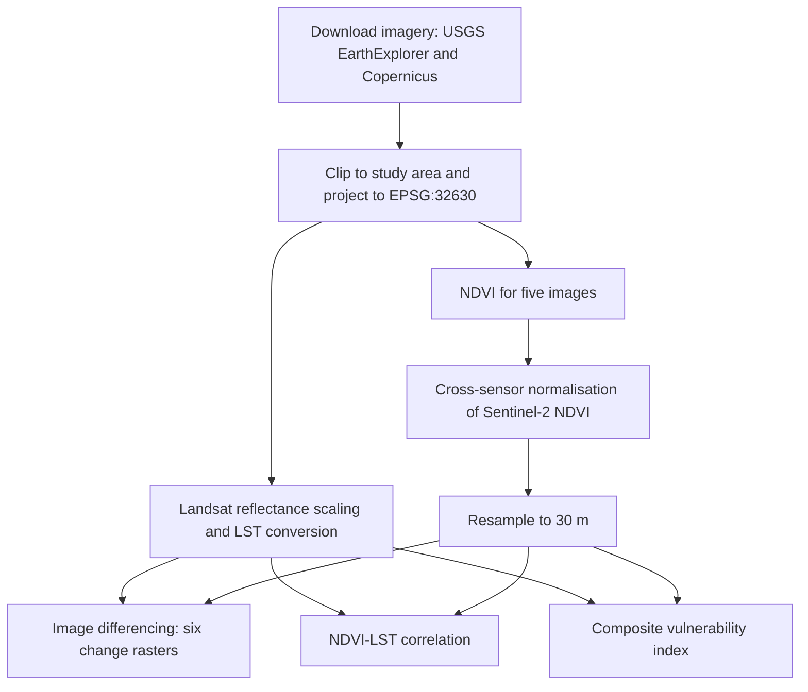

# NDVI and LST workflow (ArcMap 10.4)

How NDVI, land surface temperature (LST), change detection and the vulnerability index were produced for the thesis *Urban Green Cover Change and Its Thermal Implications in Navrongo, Ghana (2015-2025)*. These steps were done by hand in ArcMap 10.4 and Excel, not in Earth Engine.



## 1. Data

| Data | Source | Date | Used for |
|---|---|---|---|
| Landsat 8 OLI/TIRS (Path/Row 194/053) | USGS EarthExplorer | 28 Feb 2015 | NDVI and LST |
| Landsat 8 OLI/TIRS | USGS EarthExplorer | 26 Feb 2020 | LST |
| Landsat 8 OLI/TIRS | USGS EarthExplorer | 7 Feb 2025 | LST |
| Sentinel-2 MSI L2A | Copernicus | 7 Mar 2020 | NDVI |
| Sentinel-2 MSI L2A | Copernicus | 16 Mar 2025 | NDVI and classification |
| WorldPop 2025 (100 m) | WorldPop.org | 2025 | Population exposure |

All scenes were checked for cloud cover, coverage and missing sections before use.

## 2. Clip and project

- Clip every image to the 15 km2 study area with **Extract by Mask**, using the Navrongo Study Area UTM shapefile as the mask.
- Project all imagery and vector data to WGS 1984 UTM Zone 30N (EPSG:32630).

## 3. Radiometric scaling (Landsat)

Landsat Collection 2 Level-2 reflectance is stored as integers. Applied to bands B2 to B7 of all three scenes with the Raster Calculator:

```
Surface Reflectance = DN * 0.0000275 - 0.2
```

Outputs were checked to fall between 0 and 1. Sentinel-2 L2A is already bottom-of-atmosphere reflectance (scaled by 10,000), so this step was not applied.

## 4. Land surface temperature

The ST_B10 band of each Landsat scene was converted to degrees Celsius with the USGS Collection 2 scale factor:

```
LST (deg C) = DN * 0.00341802 - 124.15
```

The USGS Collection 2 Level-2 surface temperature product already includes atmospheric correction from reanalysis data, so it was used instead of a manual single-channel algorithm. Three 30 m LST rasters resulted, with mean values of 37.50 deg C (2015), 40.90 deg C (2020) and 41.27 deg C (2025).

## 5. NDVI

```
NDVI = (NIR - Red) / (NIR + Red)
```

Landsat 8 used B5 (NIR) and B4 (Red). Sentinel-2 used B8 (NIR) and B4 (Red). This gave five NDVI rasters. All images are dry season (February to March), so NDVI mostly reflects woody vegetation (mean NDVI 0.20 to 0.23).

## 6. Cross-sensor normalisation

Landsat 8 and Sentinel-2 differ in band widths and calibration, so Sentinel-2 NDVI was scaled to the Landsat 8 scale.

1. Extract co-located NDVI values from both sensors with the **Sample** tool.
2. Fit a linear regression to the paired values. Reported equation: `NDVI_S2_normalized = 1.098 * NDVI_L8 - 0.0864` (R2 = 0.749).
3. Apply the equation to both Sentinel-2 NDVI rasters (2020 and 2025) with the Raster Calculator.
4. Resample the normalised rasters from 10 m to 30 m with bilinear interpolation.

Final NDVI rasters: `NDVI_L8_2015`, `NDVI_S2_2020_norm_30m`, `NDVI_S2_2025_norm_30m`.

## 7. Change detection

Image differencing (later epoch minus earlier epoch) for NDVI and LST over three pairs: 2015 to 2020, 2020 to 2025 and 2015 to 2025. This produced six change rasters.

## 8. NDVI-LST correlation

- Sample NDVI and LST at the same pixel locations with the **Sample** tool (about 16,600 paired observations).
- Export to Excel and use `CORREL` to calculate Pearson r separately for 2015, 2020 and 2025.
- Limitation: neighbouring pixels are spatially autocorrelated, so significance values would be inflated. Pearson r is used as a descriptive measure.

## 9. Composite vulnerability index

1. Min-max normalise each layer to 0-1. LST used a minimum of 32.78 deg C and a maximum of 45.95 deg C from the 2025 raster.
2. Invert NDVI so that less vegetation gives a higher score:

```
NDVI_vuln = 1 - (NDVI - NDVI_min) / (NDVI_max - NDVI_min)
```

3. Resample WorldPop 2025 from 100 m to 30 m (bilinear) and normalise it the same way.
4. Combine in the Raster Calculator as a weighted overlay: **LST 0.4, inverted NDVI 0.4, population density 0.2**.

## 10. Field validation of the land cover map

- 63 ground control points collected with SW Maps and GNSS averaging (at least five readings per point): 50 in April 2026 and 13 in June 2026.
- Purposive stratified sampling: 15 Urban, 27 Vegetation, 14 Bare Land, 7 Water.
- Predicted classes extracted with the **Sample** tool (nearest neighbour), then a confusion matrix built in Excel with `COUNTIFS`.
- Result: Overall Accuracy 73%, Kappa 0.635.

## Software

ArcMap 10.4 (Extract by Mask, Raster Calculator, Sample), Microsoft Excel, SW Maps, Google Earth Engine (classification only).
